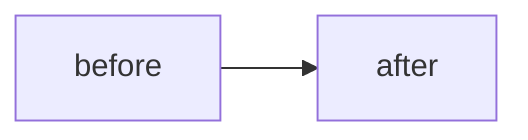

<!--
Keep the sections that apply and delete the rest — never pad with "n/a".

One PR per logical change, short-lived branch `type/scope`, Conventional Commits,
squash-merge and delete. `Closes #N` only auto-closes the issue when the PR targets
the default branch: if you stack PRs, retarget the next one to `main` after this
merges, or link the issue by hand.
-->

# Why

<!-- The problem in behaviour-facing terms: what did a user see, and what should they see? -->

# What changed

<!-- The smallest useful change, the commit list, and anything deliberately left unchanged. -->

# Visuals

<!-- One diagram beats three. Mermaid renders in the PR body — pick the shape that fits:
     sequenceDiagram (a flow through several actors), flowchart (state/branches),
     stateDiagram-v2 (a lifecycle), erDiagram (schema). -->

# Validation and proof

<!-- check → exact command → actual result. Quote real numbers, test names, log lines. -->

| Check | Command | Actual result |
| --- | --- | --- |
| Gate | `make check` | manifest 0 errors; N files compile; N passed, 0 failed |
| Shell lint | `noctalia plugins lint medo` | `ok` — 0 errors, 0 warnings |

# UI proof

<!-- Embed the screenshots, do not just link a path — a bare path is not an image.
     Relative paths only resolve inside the repository tree, so in a PR body use a full URL.
     Pin a commit (not a branch) so the image survives the branch being deleted:

     

     The same files stay at docs/screenshots/ on main after merge. -->

# Risk and rollback

- **Risk:** … (be specific: what breaks, for whom)
- **Rollback:** revert the commit; …

## Checklist

- [ ] `make check` green and `noctalia plugins lint medo` clean
- [ ] the new check/test fails without the change
- [ ] no new dependency without a stated reason
- [ ] `docs/PLAN.md` progress, `docs/DEV.md`, `AGENTS.md` and `README.md` updated when behaviour or workflow changed
- [ ] plugin data left empty and the panel closed after manual testing
- [ ] screenshots are embedded (not just linked) and the diagram is accurate

**Not verified:** <!-- say plainly what you could not check on this machine and why -->
