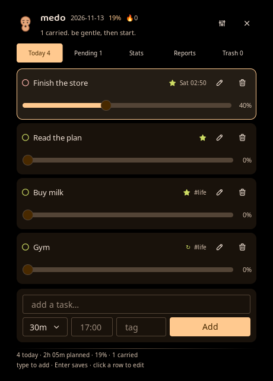
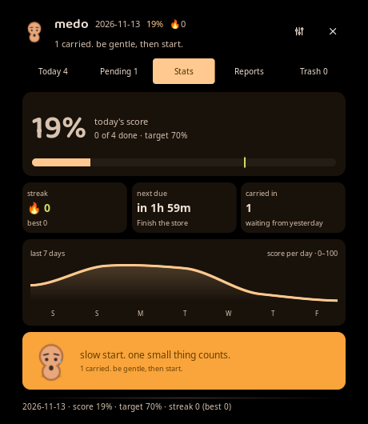
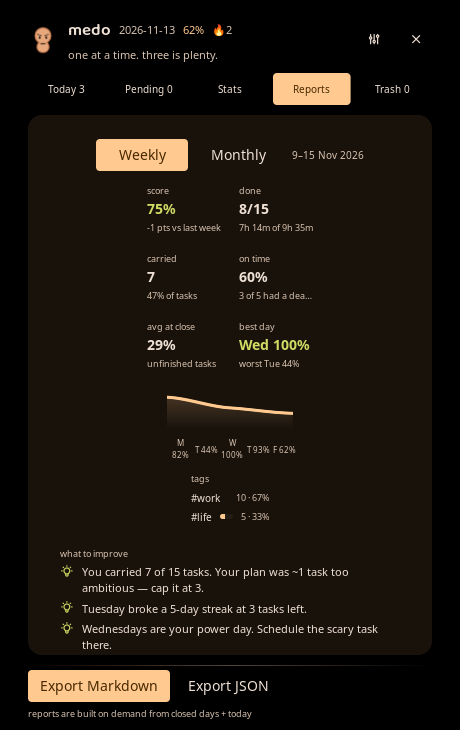
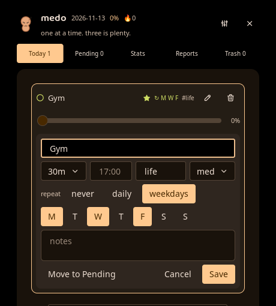
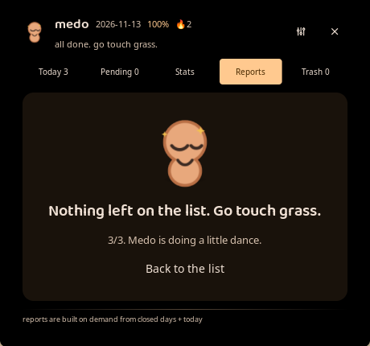

<p align="center">
  
</p>

<h1 align="center">medo</h1>

<p align="center"><strong>A cute, day-scoped task manager for <a href="https://noctalia.dev">Noctalia v5</a> on <a href="https://github.com/YaLTeR/niri">niri</a>.</strong></p>

<p align="center">The day closes itself: carry-overs are deliberate, progress is honest,<br>
and every week tells you how you actually worked.</p>

<p align="center">
  <a href="https://github.com/Goutam-11/medo/releases"></a>
  <a href="https://github.com/Goutam-11/medo/actions/workflows/ci.yml"></a>
  <a href="LICENSE"></a>
  <a href="https://noctalia.dev"></a>
  <a href="docs/PLAN.md"></a>
  <a href="tests/logic_test.luau"></a>
</p>

<p align="center">
  
</p>

## Why medo

Most task managers let an unfinished list rot quietly. medo closes the day on purpose:

- **Unfinished work is a decision, not a failure.** At the 21:00 triage you retry, park or drop
  what is left. Ignore it and rollover moves everything to **Pending** — visible, carry-counted,
  never silently deleted.
- **Progress is effort-weighted.** A 2-hour task counts more than three one-minute ticks, and the
  daily score is live while you drag the sliders.
- **The week is honest.** Reports show carryover, on-time rate, average progress at close and
  deterministic insights — no AI, no streak guilt.
- **It is local.** One JSON document in the plugin data directory, atomic writes, no account,
  no network request.

## Features

- **Five surfaces** — Today, Pending, Stats, Reports and Trash in one 460 px panel.
- **04:00 rollover, configurable** — the logical day starts at the rollover hour, so work at 01:30
  still belongs to yesterday.
- **21:00 triage** — Retry, park or drop the leftovers on one card.
- **Progress sliders and a daily score** — 0–100 % per task, 100 % completes it; effort-weighted
  score and a streak.
- **Focus stars** — the first three tasks carry the star the report's top-3 hit rate counts.
- **Repeats** — daily or selected weekdays; a completed weekday repeat waits as one Pending
  placeholder and is promoted on its next matching day.
- **Reminders and digests** — morning plan, due and lead alerts, at-risk nudge, evening triage and
  weekly/monthly reports, all quiet-hours aware and deduped across restarts.
- **Launcher capture** — `medo buy milk @17:00 #errand !high`, with a live preview of the parsed
  due time, tag and priority.
- **Reports** — weekly/monthly, configurable week start, tag split, trend, insights and
  Markdown/JSON export.
- **Trash** — soft delete, restore, 30-day auto-purge.
- **Bar widget** — Medo glyph + `done/total`, next-due tooltip, right-click Pending, and settings
  for the glyph and both halves of the capsule.
- **A blob with opinions** — the mascot, sound cues and an eight-second celebration when the list
  is empty.

## Screenshots

| Today | Stats |
| :---: | :---: |
|  |  |

| Reports | Repeat editor |
| :---: | :---: |
|  |  |

<p align="center">
  
</p>

## Requirements

- **Noctalia 5.4.1 or newer** with `plugin_api = 43` support (tested on 5.4.1).
- **niri** is the tested compositor. Other Noctalia-supported compositors may work, but are not
  verified.
- No runtime daemon, account or network access. The plugin is plain Luau and local JSON.

## Installation

### Published release (recommended)

Download the latest archive from the [releases page](https://github.com/Goutam-11/medo/releases)
and extract it into Noctalia's local plugin directory. The archive root is the `medo/` plugin
directory, so no nested `author/` folder is needed:

```bash
VERSION=0.2.0
curl -fL -o /tmp/medo.tar.gz \
  "https://github.com/Goutam-11/medo/releases/download/v${VERSION}/medo-v${VERSION}.tar.gz"

mkdir -p ~/.local/share/noctalia/plugins
tar -xzf /tmp/medo.tar.gz -C ~/.local/share/noctalia/plugins

noctalia msg config-reload
noctalia msg plugins enable goutamsharma/medo
noctalia msg plugins list | grep medo
```

The last command should print `goutamsharma/medo [local] 0.2.0 enabled`.

Add the bar widget from Noctalia's bar settings, or in
`~/.local/state/noctalia/settings.toml`:

```toml
[bar.default]
start = [ "launcher", "wallpaper", "workspaces", "medo" ]

[widget.medo]
type = "goutamsharma/medo:bar"
```

Then `noctalia msg config-reload`. The capsule shows the glyph and `done/total`; its settings
(`glyph`, `show_count`, `show_mascot_dot`) live in the widget settings.

### Unreleased `main` (development)

`main` is the development branch and may be ahead of the latest release. Use it to test fixes, not
for a stable install:

```bash
git clone https://github.com/Goutam-11/medo.git ~/src/medo
cd ~/src/medo

make tools     # fetch the pinned Luau 0.746 toolchain into .tools/
make check     # manifest + translations + compile + 503 unit tests

noctalia msg plugins source add medo-dev path "$PWD"
noctalia msg plugins enable goutamsharma/medo
```

A `path` source points at a **directory of plugin directories**, so point it at the repository
root (which contains `medo/`), not at `medo/` itself. If a release is already installed, disable
it and remove the `~/.local/share/noctalia/plugins/medo/` copy first — two sources with the same
plugin id conflict.

To use the stable source instead of `main`:

```bash
git clone --branch v0.2.0 --depth 1 https://github.com/Goutam-11/medo.git ~/src/medo
```

### Updating

- **Release install:** extract the new archive over `~/.local/share/noctalia/plugins/`, then
  `noctalia msg config-reload`. Your tasks live in the plugin data directory and are not touched.
- **Path source:** `git pull` in the checkout; `.luau` files hot-reload. `plugin.toml` changes need
  `noctalia msg config-reload`.

### Uninstalling

```bash
noctalia msg plugins disable goutamsharma/medo
rm -rf ~/.local/share/noctalia/plugins/medo   # release install
# remove the medo-dev path source if you added one:
# noctalia msg plugins source remove medo-dev
```

Plugin data stays in `~/.local/state/noctalia/plugins/data/goutamsharma/medo/`; delete that
directory separately if you want a clean slate.

## Usage

### Capture a task

- **Launcher:** type `/medo buy milk @17:00 #errand !high`. Tokens: `@HH:MM`, `@tomorrow`,
  `@mon`…`@sun`, `#tag`, `!low/!med/!high`; everything else stays in the title.
- **Panel:** open the add field, type, press <kbd>Enter</kbd>. The field keeps focus for the next
  capture.
- **Global shortcut:** bind the panel in your compositor — the plugin deliberately has no global
  or in-panel shortcuts.

```kdl
// niri config.kdl
Mod+Shift+M hotkey-overlay-title="medo: capture a task" { spawn-sh "noctalia msg panel-open goutamsharma/medo:panel add"; }
Mod+Alt+M   hotkey-overlay-title="medo: open today"      { spawn-sh "noctalia msg panel-open goutamsharma/medo:panel"; }
Mod+Alt+T   hotkey-overlay-title="medo: evening triage"  { spawn-sh "noctalia msg panel-open goutamsharma/medo:panel triage"; }
```

### The daily loop

1. **Plan** up to three tasks in Today. The cap is soft: a fourth asks before adding.
2. **Work** with the sliders; 100 % completes a task and plays the chime.
3. **Triage** at 21:00 — Retry keeps it, Park sends it to Pending, Drop moves it to Trash.
4. **Rollover** at 04:00 archives done work, carries unfinished work to Pending with `×N`, recreates
   repeats and snapshots the day into history.
5. **Review** the week in Reports; export Markdown or JSON if you want it outside medo.

### Tabs

| Tab | What it is for |
| --- | --- |
| **Today** | The committed day: add, edit, slide, complete, park, delete. |
| **Pending** | Carried work and deliberately parked work, waiting for a decision. |
| **Stats** | Score, streak, next due, 7-day sparkline and the mascot's mood. |
| **Reports** | Weekly/monthly metrics, insights, export. |
| **Trash** | Restorable deletions with a 30-day countdown. |

### Bar widget

The capsule shows the glyph and `done/total`; the tooltip carries the next due task and a
countdown. Left-click opens Today, right-click opens Pending. Hiding both the count and the glyph
falls back to the count, so the bar never renders an empty capsule.

<p align="center">
  
</p>

## Configuration

Everything is configured from **Noctalia → Settings → Plugins → medo**, or in
`~/.local/state/noctalia/settings.toml` under `[plugin_settings."goutamsharma/medo"]`, followed by
`noctalia msg config-reload`.

| Setting | Default | Purpose |
| --- | --- | --- |
| `rollover_hour` | `4` | Logical day boundary (0–23). |
| `cap_enabled` / `daily_cap` | `true` / `3` | Soft cap on Today's list. |
| `default_estimate` | `20` | Minutes a task is worth when it has no estimate. |
| `week_start` | Monday | First day of the weekly report range and chart. |
| `streak_threshold` | `70` | Daily score that keeps a streak. |
| `lead_min` | `15` | Default reminder lead time. |
| `trash_days` | `30` | Days a deleted task stays restorable. |
| `export_dir` | Documents | Where Markdown/JSON reports are written. |
| `sounds_enabled` / `mascot_enabled` | `true` | Chime/jingle/thud and the blob artwork. |
| `notify_morning` … `notify_atrisk` | `true` | Per-notification toggles. |
| `morning_time` / `evening_time` / `atrisk_time` | `08:00` / `21:00` / `15:00` | Notification schedule. |
| `weekly_day` / `weekly_time` / `monthly_time` | Sunday / `20:00` / `20:00` | Report cadence. |
| `quiet_start` / `quiet_end` | `22:00` / `07:00` | Quiet hours (due alerts still fire). |

Widget settings: `glyph` (default `checklist`), `show_count` and `show_mascot_dot` (both `true`).
See [`docs/PLAN.md`](docs/PLAN.md) §9 for the full schema and [`docs/DEV.md`](docs/DEV.md) for the
development seams.

## Data and privacy

Everything is local; medo makes no network request.

```
noctalia.pluginDataDir()  →  ~/.local/state/noctalia/plugins/data/goutamsharma/medo/
├── tasks.json         live document (schema 1): day, rollover_hour, carried_in, streak, tasks, trash
├── tasks.json.bak     previous generation, used when tasks.json is unreadable
├── history.json       one aggregate snapshot per closed day
├── state.json         notification dedupe (day + already-fired keys)
└── backups/           tasks-<day>.json, newest 14, written at each rollover
```

Writes are atomic (encode → `.tmp` → rotate to `.bak` → rename), so a crash never leaves a
half-written day; a corrupt file falls back to the previous generation. Nothing is written inside
the plugin directory.

**Reports** export to `export_dir` (empty = `$XDG_DOCUMENTS_DIR`, else `~/Documents`) as
`medo-<period>-<end-day>.md` or `.json`.

**Import** is available through the service command (`kind = "import"`) and the
`debug-import <path>` seam. It merges a `tasks.json`-shaped document by task id, replaces matching
ids in place, appends new ones and merges trash — it never wipes the live list. There is no panel
UI or task-document export command in 0.2.0; a copy of `tasks.json` or a `backups/` file is a valid
input.

## Troubleshooting

- **Plugin not listed after a release install:** confirm the directory is
  `~/.local/share/noctalia/plugins/medo/` (flat, not `goutamsharma/medo/`), then
  `noctalia msg config-reload`.
- **`cannot enable … no plugin found in any source`:** same check; the local loader scans the
  flat directory only.
- **Panel does not open:** `noctalia msg panel-open goutamsharma/medo:panel` should open it. If you
  use niri, remember that a fullscreen window hides layer panels — switch to an empty workspace.
- **Manifest edits do nothing:** `plugin.toml` changes need `noctalia msg config-reload`; `.luau`
  edits hot-reload.
- **Logs:** `~/.cache/noctalia/noctalia.log`; filter with
  `grep -iE 'medo|ERR|luau' ~/.cache/noctalia/noctalia.log | tail -50`.

## Development

```bash
make tools     # fetch the pinned Luau 0.746 toolchain into .tools/ (once)
make check     # manifest + translations + compile + 503 unit tests — the CI gate
make test      # TZ=UTC .tools/luau tests/logic_test.luau
make lint      # noctalia plugins lint medo (needs the running shell)
```

CI ([`.github/workflows/ci.yml`](.github/workflows/ci.yml)) runs `make check` on every PR and on
`main`. The pure rules live in `medo/logic.luau` and are tested headlessly; the service is the only
writer; the panel, bar and launcher send intents and never touch disk.

```
medo/                 the Noctalia plugin: manifest, service, panel, bar widget, launcher, assets
medo/logic.luau       pure rules: dates, score, rollover, repeats, reports, insights, capture
medo/core.luau        service: the only writer, rollover, reminders, reports, commands
medo/store.luau       the only disk module: atomic JSON, backups, exports, reads
medo/panel.luau       five-tab panel; writes nothing
medo/bar.luau         bar widget; renders the published view
medo/quick.luau       launcher provider; sends the same `add` command
tests/logic_test.luau headless tests for the pure layer
docs/                 PLAN.md (contract) · DEV.md (workflow) · screenshots/
tools/                manifest validator · asset generator
```

Start with [`AGENTS.md`](AGENTS.md), then [`docs/PLAN.md`](docs/PLAN.md) (the locked decisions and
schema) and [`docs/DEV.md`](docs/DEV.md) (dev loop, IPC cheat-sheet, platform gotchas).

## Contributing

Issues and pull requests are welcome. Please:

1. Read the locked decisions in [`docs/PLAN.md`](docs/PLAN.md). If a change contradicts the table,
   amend the decision in the same PR and say why — silent contract drift is not accepted.
2. Keep `logic.luau` host-free; only `core.luau` mutates state; `store.luau` owns disk. New
   user-visible copy goes in `medo/translations/en.json`.
3. Add tests for pure rules and run `make check` before opening the PR.
4. Use Conventional Commits and fill in the
   [pull request template](.github/pull_request_template.md), including what you could **not**
   verify.
5. One logical change per PR. Do not add a dependency without a stated reason.

The plugin targets **`plugin_api = 43`** and is verified on Noctalia 5.4.1; newer API props are
silently skipped by the shell, so keep to the 43-era surface.

## Known limitations

- Notifications carry no action buttons; triage is a panel context opened from a compositor bind.
- There are no in-panel keyboard shortcuts by design (the compositor owns global keys).
- No animations at API 43; the celebration is a static card plus a jingle.
- No cloud sync, multi-device sync or time tracking in v1.
- Import has no panel UI yet (service/`debug-import` seam only).

## License

Released under the [MIT License](LICENSE). The bundled **Baloo 2 SemiBold** font is separate:
SIL Open Font License 1.1, see [`medo/assets/fonts/OFL.txt`](medo/assets/fonts/OFL.txt). The mascot
artwork and sound cues were generated for this project.

## Acknowledgements

- [Noctalia](https://noctalia.dev) for the shell, plugin API and declarative UI — and its Tabler
  glyph set.
- [niri](https://github.com/YaLTeR/niri) for the compositor the plugin is developed and tested on.
- [Baloo 2](https://fonts.google.com/specimen/Baloo+2) by Ek Type, under the SIL OFL 1.1.
- [Luau](https://luau.org) for the language and the headless test runner.
