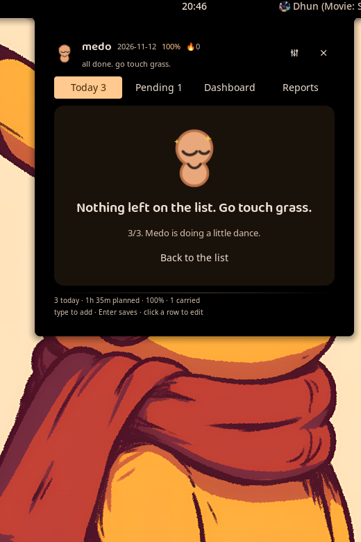
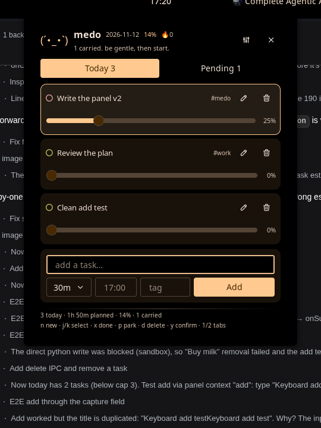
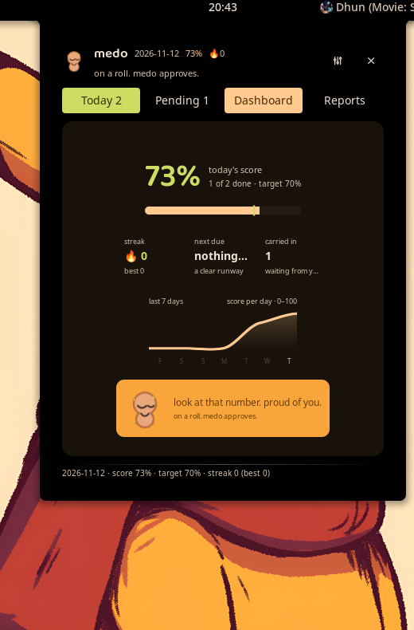
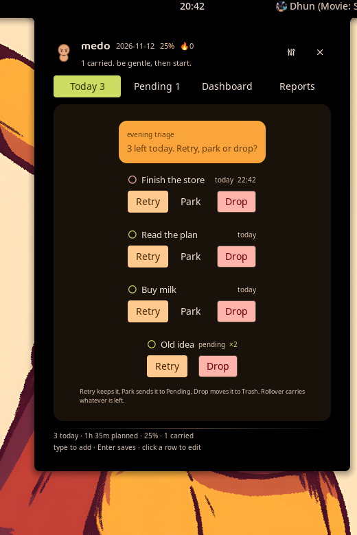
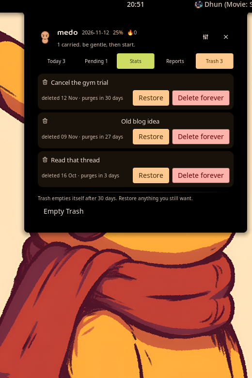
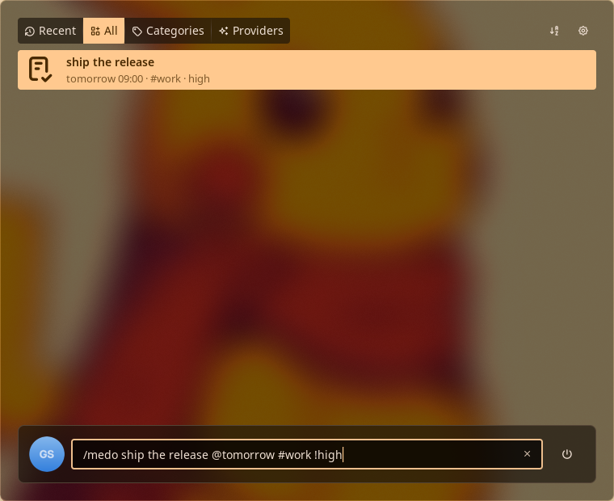
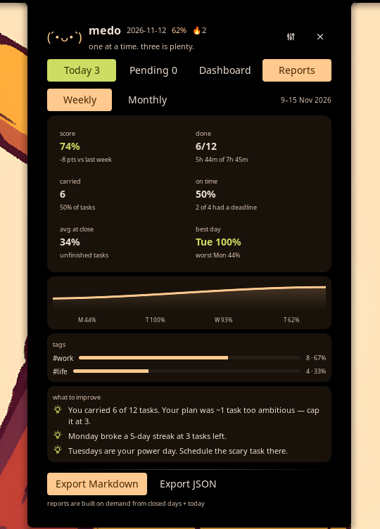

# medo

A cute, day-scoped task manager for **Noctalia v5** on niri.

> The day closes itself: carry-overs are deliberate, progress is honest, and every week
> tells you how you actually worked.

**Status:** Phase 5 — feature complete for v1 (`0.2.0`). Today, Pending, Stats, Reports and Trash;
progress sliders; a 04:00 rollover with a 21:00 triage; the reminder scheduler; launcher capture;
the mascot, sound cues and celebration; Markdown/JSON report export; and a Trash with a restorable
countdown. The store persists everything, rolls the day over at 04:00 and never loses a day.

<p align="center">
  
</p>

## What it does

- **Five tabs** — Today, Pending, Stats, Reports and Trash: the plan, the leftovers, the numbers,
  the history and the mistakes, all restorable for 30 days.
- **Progress that means something** — a per-task 0–100 % slider (100 % = done) and an
  effort-weighted daily score, so a 2-hour task counts more than three one-minute ticks.
- **04:00 rollover with a human decision** — leftovers land in Pending with a `carried ×N`
  badge, and a 21:00 triage lets you retry, park or drop instead of letting a backlog rot.
- **Weekly and monthly reports** — completion, carryover, on-time rate, average progress at
  close, streaks, plus deterministic "what to improve" lines and Markdown/JSON export. The week
  can start on any day (`week_start`, default Monday); monthly ranges stay calendar months.
- **Reminders and digests** — morning plan, due-time and lead-time nudges, at-risk ping,
  weekly/monthly report toasts, all quiet-hours aware and deduped across restarts.
- **Capture from the launcher** — `medo buy milk @17:00 #errand !high`, tokenised and previewed.
- **A blob with opinions** — Medo lives on the bar (`2/5`), in the panel and on the dashboard,
  chimes when you finish something and dances when the list is empty.
- **A 21:00 triage instead of a guilt trip** — Retry, park or drop what is left, on one card.

| | |
|---|---|
|  |  |
|  |  |
|  |  |

## Requirements

- Noctalia **5.4.1 or newer** — medo targets `plugin_api = 43` and refuses nothing newer
- A compositor Noctalia supports (niri on the reference machine)
- No extra runtime: no daemon, no network, no Python at run time

## Install

medo is not published yet, so install it from a checkout.

**Path source (what this project is developed with).** Noctalia treats a path source as a
directory *of plugin directories*, and the plugin directory must be named after the id suffix
(`medo/` for `goutamsharma/medo`). The repository root is therefore the source:

```bash
git clone https://github.com/Goutam-11/medo ~/personal-projects/medo
noctalia msg plugins source add medo-dev path ~/personal-projects/medo
noctalia msg plugins enable goutamsharma/medo
```

Add the bar widget (Noctalia's settings UI can do this too):

```toml
# ~/.local/state/noctalia/settings.toml
[bar.default]
start = [ "launcher", "wallpaper", "workspaces", "medo" ]

[widget.medo]
type = "goutamsharma/medo:bar"
```

The bar capsule shows the Medo glyph and `done/total`. Its settings are `glyph`, `show_count` and
`show_mascot_dot`; hiding both still leaves the count, so the capsule is never empty. The tooltip
carries the next due task with a countdown (`in 42m · "Finish the report"`). Left-click opens
Today; right-click opens Pending.

**Community layout.** To install a release tarball by hand, copy the contents of `medo/` (the
directory holding `plugin.toml`) to `~/.local/share/noctalia/plugins/goutamsharma/medo/`, then
`noctalia msg plugins enable goutamsharma/medo`. `plugin.toml` changes need
`noctalia msg config-reload`; `.luau` edits hot-reload.

**Optional niri binds** (global shortcuts are the compositor's job — the panel deliberately has
none):

```kdl
Mod+Shift+M hotkey-overlay-title="medo: capture a task" { spawn-sh "noctalia msg panel-open goutamsharma/medo:panel add"; }
Mod+Alt+M   hotkey-overlay-title="medo: open today"      { spawn-sh "noctalia msg panel-open goutamsharma/medo:panel"; }
Mod+Alt+T   hotkey-overlay-title="medo: evening triage" { spawn-sh "noctalia msg panel-open goutamsharma/medo:panel triage"; }
```

## Data and privacy

Everything is local; medo never makes a network request.

```
noctalia.pluginDataDir()  →  ~/.local/state/noctalia/plugins/data/goutamsharma/medo/
├── tasks.json         live document (schema 1): day, rollover_hour, carried_in, streak, tasks, trash
├── tasks.json.bak     previous generation, used when tasks.json is unreadable
├── history.json       one aggregate snapshot per closed day
├── state.json         notification dedupe (day + already-fired keys)
└── backups/           tasks-<day>.json, newest 14, written at each rollover
```

Writes are atomic (encode → `.tmp` → rotate to `.bak` → rename), so a crash never leaves a
half-written day, and a corrupt file falls back to the previous generation. Nothing is written
inside the plugin directory.

**Exports** go wherever `export_dir` points (empty = `$XDG_DOCUMENTS_DIR`, else `~/Documents`) as
`medo-<period>-<end-day>.md` or `.json`, written on demand from the Reports tab. Exported
documents are plain text you own; they are not part of the plugin data.

Deleted tasks stay restorable in Trash until they age past `trash_days` (default 30); the purge
runs at rollover, not on a timer.

## Development

```bash
make check     # manifest + translation keys + Luau compile + unit tests (exactly what CI runs)
make tools     # fetches the pinned Luau toolchain into .tools/
make lint      # noctalia plugins lint (needs the running shell)
./tools/gen-assets.sh   # rebuild the mascot PNGs and the sound cues from their sources
```

CI (`.github/workflows/ci.yml`) runs `make check` on every pull request and on `main`.
[docs/DEV.md](docs/DEV.md) has the dev-source setup, the IPC cheat-sheet, the launcher recipe and
the platform gotchas that cost hours. [docs/PLAN.md](docs/PLAN.md) holds the locked decisions and
the build plan. `AGENTS.md` is the orientation file for contributors (and agents).

## Layout

```
medo/       the Noctalia plugin: manifest, service, panel, bar widget, launcher, assets, translations
docs/       PLAN.md · DEV.md · screenshots/
tests/      headless tests for the pure logic
tools/      gen-assets.sh · check_manifest.py
```

## Text and translations

Every user-visible string lives in [medo/translations/en.json](medo/translations/en.json) and is
resolved with `noctalia.tr` / `noctalia.trp`. The pure logic returns copy *keys* and their
numbers, never sentences, so a second language only needs a new JSON file. `make manifest` fails
CI when a key used in the code is missing from the catalogue.

Known exception: exported Markdown/JSON reports (and debug IPC toasts) are built in English. They
are documents and developer seams, not UI.

## License

**TBD — no licence has been chosen for this project.** The plugin code is therefore "all rights
reserved" by default. Bundled third-party assets are separate: Baloo 2 SemiBold ships under the
SIL Open Font License 1.1 (`medo/assets/fonts/OFL.txt`); the mascot artwork and sound cues were
generated for this project by `tools/gen-assets.sh`.

Choosing a licence is a deliberate act, so it is left open rather than invented — see
`docs/PLAN.md` §13 and the Phase 5b note.
